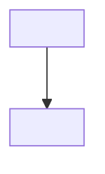

# <Sujet> : <titre de la doc vivante>

> Modèle de **doc vivante** : note d'analyse durable sur un sujet transverse (architecture d'un système, dette technique, coexistence de mécanismes).
>
> Non chargée par défaut : lue en opt-in ou via grep ciblé. La garder à jour quand le sujet évolue.

## Résumé

<3-5 phrases : de quoi parle ce document, quel problème il adresse.>

---

## État actuel

<Existant : schéma, flux, acteurs.>



---

## Flux détaillés

### 1. <Flux 1>

```
<étapes>
```

---

## Problèmes constatés

- <problème 1, avec sa conséquence concrète>

---

## Décision proposée

### Principe

<Choix, pourquoi, alternatives écartées.>

### Changements concrets

1. <changement 1>

### Ce qui ne change pas

- <invariant>

### Impacts

- <impact>

---

## Questions en suspens

1. <question 1>
